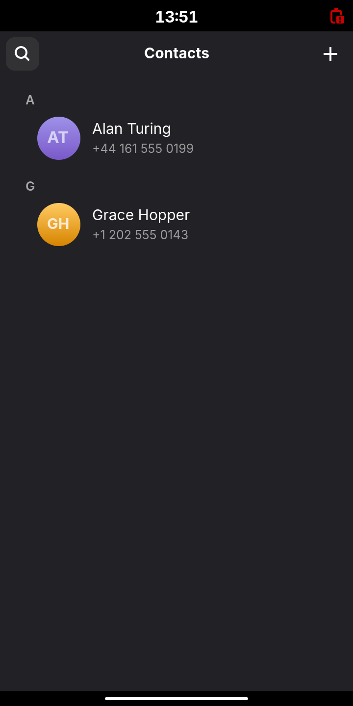
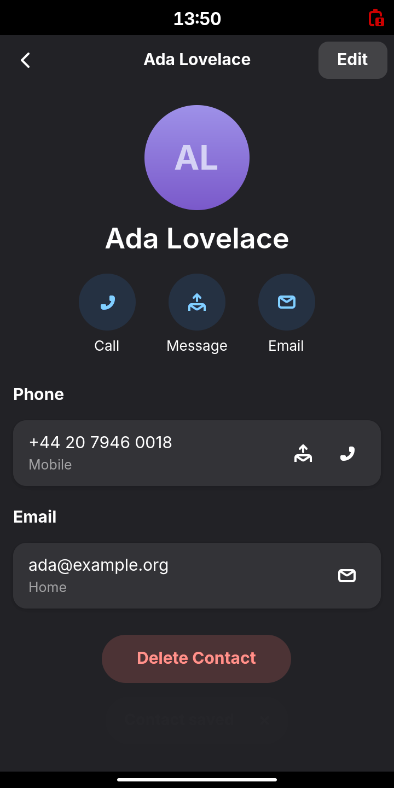
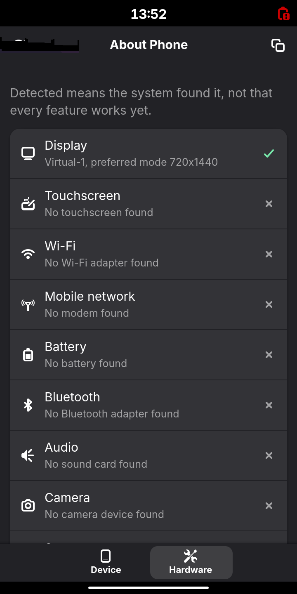

# jinos_ui

The jinOS look for Python + GTK4/libadwaita apps: standard libadwaita
layout (header bars, cards, tabs), a little larger, Inter type, the jinOS
accent colour, and the same icons in every shell.

  

## Use

```python
import jinos_ui

class App(Adw.Application):
    def do_startup(self):
        Adw.Application.do_startup(self)
        jinos_ui.init()          # once per app
```

Build screens from ordinary libadwaita widgets: `Adw.HeaderBar` (hide the
window close button with `show_end_title_buttons=False`; phones close apps
from the task switcher), `Adw.PreferencesGroup` cards, `Adw.ViewSwitcherBar`
for bottom tabs. jinos_ui adds:

| Helper | What it is |
|---|---|
| `SectionHeader(text)` | Small grey label above a group, or a letter in an A-Z list |
| `ActionButton(icon, label, callback)` | Round button with a label underneath, for quick actions like Call |
| `avatar(name, size)` | Round avatar with initials |

CSS classes: `jinos-name` (big name on a detail page), `jinos-hint`.

## What `init()` does

- Follows the system's light or dark setting.
- Uses the Adwaita icon theme, so icons are the same under Phosh and Plasma
  (Breeze lacks several icons GTK apps use).
- Loads `style.css`: Inter, 15px text, taller rows.
- Sets the accent colour: `DEFAULT_ACCENT` (`#3584e4`) unless
  `~/.config/jinos/ui.ini` has `[style]` `accent = #rrggbb`. Both
  `--accent-bg-color` and the derived `--accent-color` are set; setting only
  the first leaves focus rings in the system accent (orange on Ubuntu).
