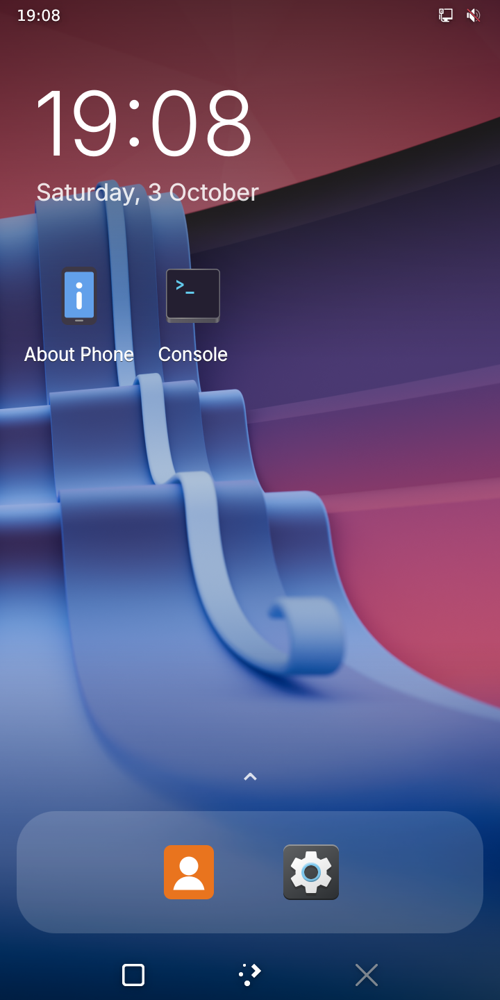
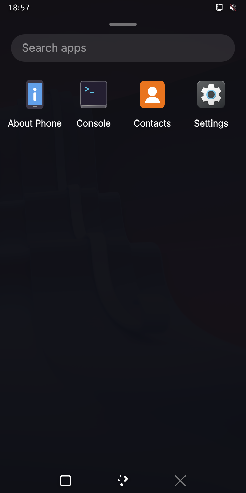
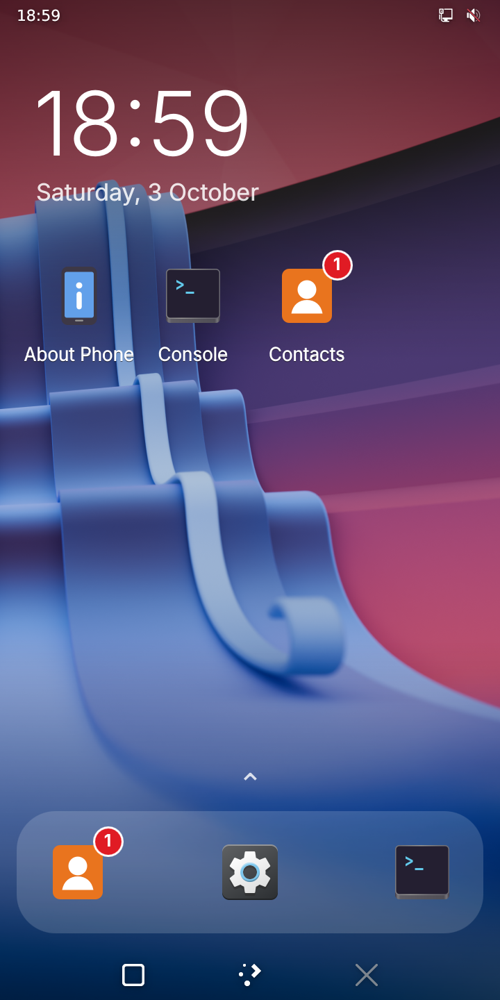
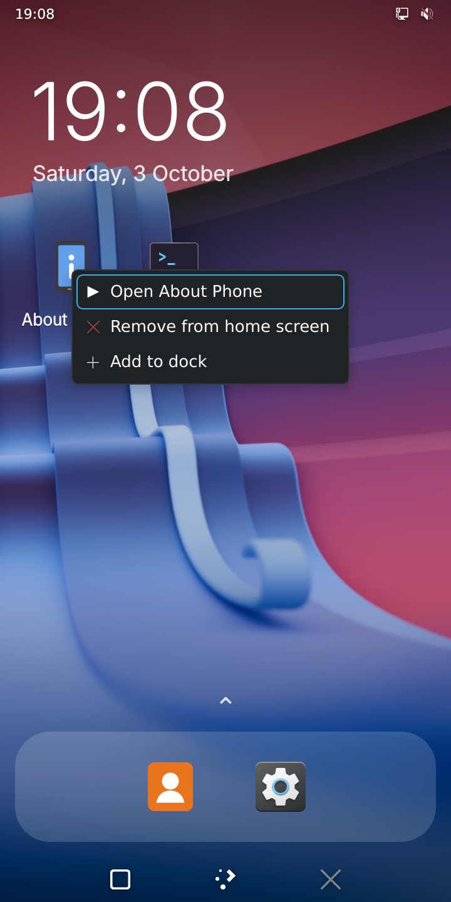

# jinOS Home

The jinOS home screen: a familiar phone layout, as a Plasma Mobile
home-screen plugin (a Plasma "containment") written in QML. It is the
default home screen of the jinOS image.

   

## What it does

- Clock and date at the top, then a grid of app icons with labels.
- A dock at the bottom with up to four apps. Fewer than four sit together
  in the middle.
- Swipe up anywhere on the home screen, or tap the ⌃ handle, for the app
  drawer: every app, alphabetically, with search. Pull the drawer's handle
  down (or overscroll the list downwards) to close it; the home button also
  closes it.
- Labels use the short name: an app named "Example Web Browser" whose
  generic name is "Web Browser" shows as "Example".
- Press and hold any app, on the home screen, in the dock or in the drawer,
  for a menu: Open, Add to/Remove from home screen, Add to/Remove from dock.
- Red badges show how many notifications arrived for an app since you last
  opened it from jinOS Home. Dismissing the notifications clears the badge too.

## Settings

Plasma applet settings (`contents/config/main.xml`):

- `dock`, `home`: ordered lists of desktop file ids. Apps that are not
  installed are skipped, so one list serves every build: the camera app is
  only in the OnePlus 6 image. Default dock: Phone (Calls), Chats, Firefox,
  Contacts. Default home screen: Camera, Photos, Clock, Calendar, Weather,
  Calculator, Settings, Files, About Phone, Console.
- `seen`: when each app was last opened from jinOS Home (JSON), for badges.

## Code

| File | What |
|---|---|
| `contents/ui/main.qml` | Home page, dock, swipe-up gesture, menu, app and notification models |
| `contents/ui/AppDrawer.qml` | The drawer |
| `contents/ui/AppIcon.qml` | One icon with label and badge |
| `contents/ui/logic.js` | Plain logic (lists, badges, text cleanup), no QML |
| `tests/logic.test.js` | Unit tests for `logic.js` |

    node --test tests/*.test.js

## How it is built in

`../../image/shells/plasma/postinst.chroot` runs `install.sh` and points
Plasma Mobile's default home screen (`Containment=` in
`/usr/share/plasma/shells/org.kde.plasma.mobileshell/contents/defaults`)
at `org.jinos.home`.

## Notes

- Apps come from the "All Applications" row of `Kicker.RootModel`; a
  standalone `Kicker.AppsModel` returns nothing under Plasma Mobile.
- `appNameFormat: 1` (generic name only) is set because only in that mode
  does Kicker give both names: `description` is the full name and
  `compactName` the generic name. `display` is then the generic name, so the
  drawer sorts and searches on `description`.
- Notifications are grouped by desktop entry here; Plasma's per-app filter
  and unread count don't fit badges (see `../start/README.md`).
- `org.kde.plasma.private.*` modules are private KDE API. Check jinOS Home
  after every Plasma upgrade.
- `../start` is the earlier Quiet Metro home screen. It is kept for
  reference and is not installed.

## Tested

In the VM (`../../image/run-vm.sh`): first boot straight to Home, launching
from home, dock and drawer, drawer swipe up and handle drag down, search,
the menu (add to home, add to dock), badges appearing on a test
notification and clearing when the app is opened, and Plasma's log free of
warnings from jinOS Home.

Not yet tested: a real touchscreen (the VM uses a pointer), more apps than
fit on one screen, and the OnePlus 6.
