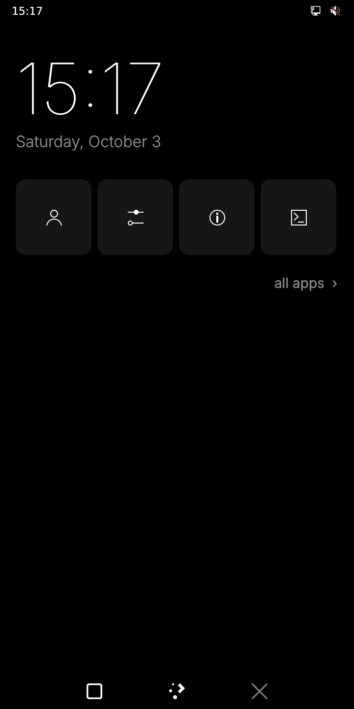
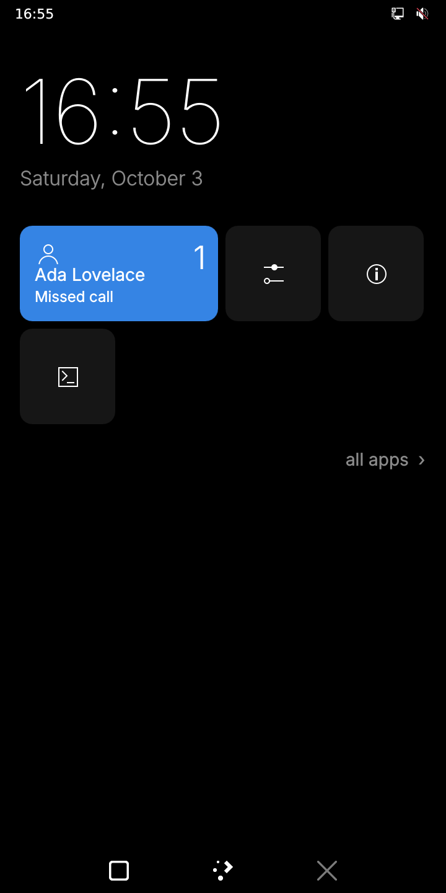
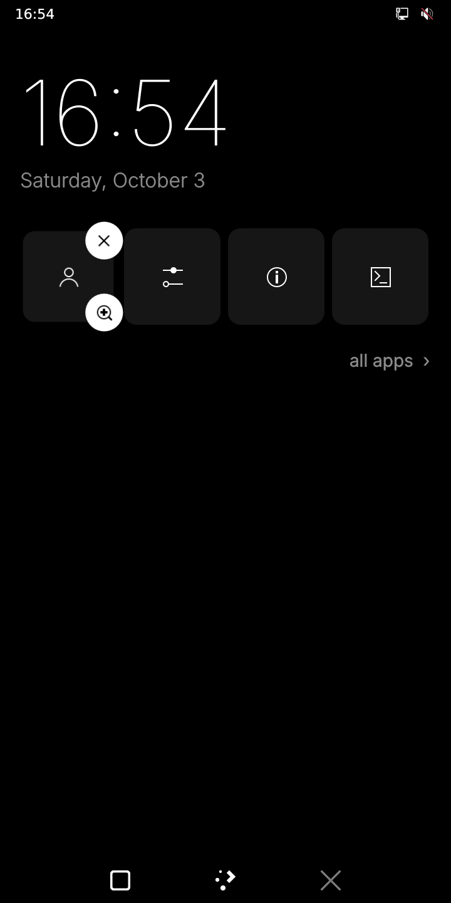
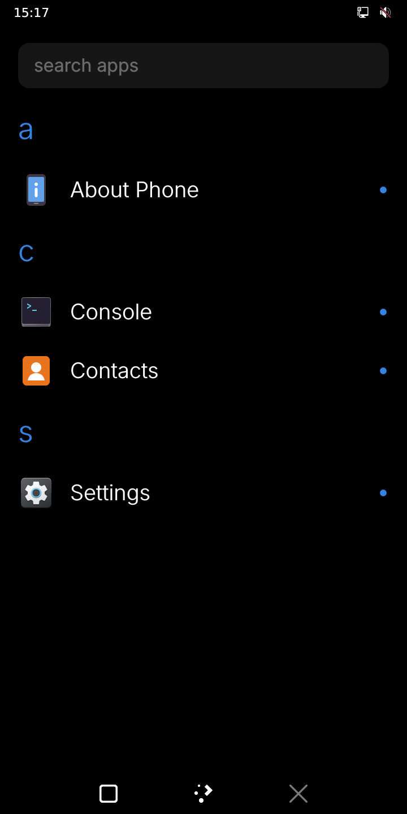

# jinOS Start

The Quiet Metro home screen, as a Plasma Mobile home-screen plugin
(a Plasma "containment") written in QML.

   

## What it does

- Big thin clock and date, then tiles on black.
- Small tiles: a monochrome glyph; tap to open.
- Press and hold a tile for edit mode: an unpin button and a resize button
  (small or wide) appear on it. Tap anywhere else to finish.
- Wide tiles are live: the newest notification for that app (sender, then
  message) and a count, or the battery (`jinos:battery`, hidden on devices
  without one). A tile turns the accent colour while it has notifications
  that arrived since you last opened the app from Start; opening it, or
  dismissing the notifications, clears it.
- With nothing pinned, Start explains how to pin apps.
- Swipe left, or tap "all apps", for the alphabetical app list with
  accent letter headers and search (the list itself is filtered, so empty
  letter headers disappear). Press and hold an app to pin or unpin it.
- The home button returns to the top of Start.

## Settings

Stored as normal Plasma applet settings (`contents/config/main.xml`):

- `tiles`: ordered list of `desktop-file-id|size`, size `wide` or `small`.
  Apps that are not installed are skipped.
- `seen`: when each tile's app was last opened from Start (JSON).
- `accentColor`: the one accent colour.

## How it is built in

`../../image/mkosi.profiles/plasma/postinst.chroot` runs `install.sh` and
changes Plasma Mobile's default home screen (`Containment=` in
`/usr/share/plasma/shells/org.kde.plasma.mobileshell/contents/defaults`)
to `org.jinos.start`. Only the Plasma image variant includes it.

## Things learned the hard way

- `Kicker.AppsModel` on its own returns no apps under Plasma Mobile; the
  "All Applications" row of `Kicker.RootModel` (what Kickoff uses) works.
- The session needs `XDG_MENU_PREFIX=plasma-` so KDE finds its app menu.
- Tile glyphs must be `-symbolic` icon names; masking a full-colour icon
  draws a solid shape.
- Plasma's notification model filter (`whitelistedDesktopEntries`) and its
  `unreadNotificationsCount` don't fit live tiles: other tiles lit up, and
  notifications still on screen as popups were not counted. Start keeps one
  notification list and groups it by desktop entry itself.
- Notification bodies come back as HTML; strip tags before showing them.
- `upower` is only a recommended package; without it there is no battery data.
- `org.kde.plasma.private.*` modules are private KDE API and can change
  between Plasma releases. Check Start after every Plasma upgrade.

## Not tested yet

- Live tiles with real apps: tested with a test notification sent as
  Contacts; GNOME Calls and Chatty, the apps the default wide tiles are
  for, are not installed.
- The battery tile on real hardware (the VM has no battery).
- Accent colour changes at runtime (no settings page yet).
